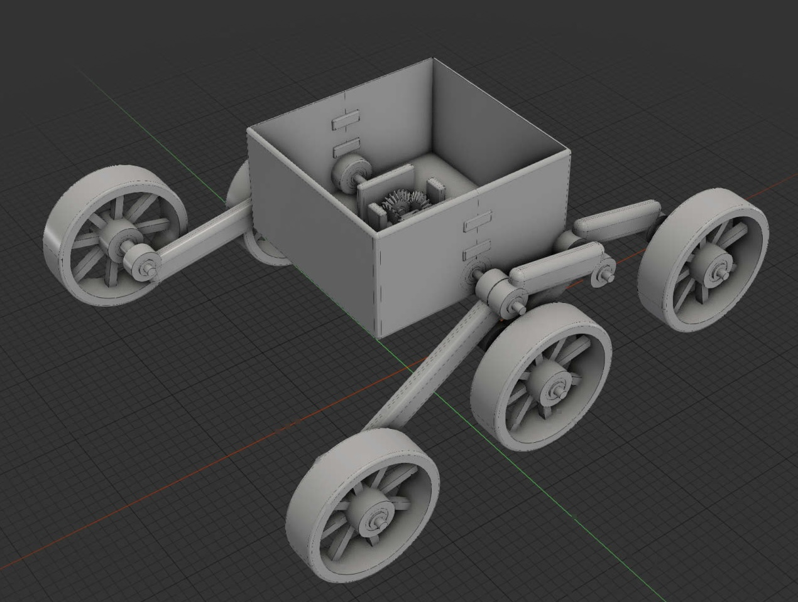

# YapRover

YapRover is an open, conventionally printable rocker-bogie rover designed
with the [yapCAD](https://github.com/rdevaul/yapCAD) procedural CAD system.
It is both a practical rover project and an integration showcase for yapCAD's
DSL, analytic BREP modeling, annotated assembly datums, mate solving,
mechanical joint coupling, manufacturing metadata, and `.ycpkg` packages.



The design is currently a pre-alpha engineering prototype. Geometry and
kinematics are under active validation and must not yet be treated as a
production-ready mechanical design.

## How rocker-bogie works

For a quick visual introduction, see this short
[rocker-bogie suspension and drive explanation](https://www.youtube.com/shorts/hO8DbfE7hJw).
The [rocker-bogie overview on Wikipedia](https://en.wikipedia.org/wiki/Rocker-bogie)
provides additional history, terminology, and diagrams. YapRover uses the same
six-wheel rocker-and-bogie topology and a differential linkage that couples
the left and right rockers; its optional wheel-drive system is still a future
design study rather than part of the passive first prototype.

## Repository layout

- `designs/` contains the yapCAD DSL source of record.
- `src/yaprover/` contains rover-specific kinematic and validation tools.
- `tests/` verifies the numerical oracle, mate-solved assembly, analytic
  geometry, and mechanical clearances.
- `docs/` contains design, fabrication, and fit-validation documentation.
- `bom/` contains the reviewed procurement catalog and generated purchase
  and cut lists; `manufacturing/` documents release-generation policy.
- `releases/` is reserved for versioned `.ycpkg` design releases.

The release assembly is `designs/yaprover_suspension_detailed.dsl`; the
smaller suspension, link, and interface files are earlier studies used by
their own tests. Apply production fit changes to the detailed source.

## Design overview (v0.2)

- **Chassis:** a 300 x 195 x 10 mm optical-breadboard deck with 42 1/4-20
  holes on a 25 mm grid for walls, batteries and payload, and two integral
  rocker towers carrying the paired 608 pivot bearings. The 1/4-20 holes are
  modelled as tap drills; `tools/thread_plate.py` cuts printable threads into
  the exported deck STEP.
- **Suspension:** one-piece rockers and bogies with chamfered (print-flat)
  arms, keyed to the rocker shafts with DIN 6885 3 x 3 keys. Range-of-motion
  stops are rigid PET-G pads printed into the chassis towers (rocker,
  +/-18 degrees) and onto the rockers (bogie, -35/+38 degrees); there are no
  separate bumper parts.
- **Differential:** a removable four-gear miter cartridge on a gusseted base
  frame on the deck, bolted through it with eight M4 x 25 screws and nylocs.
- **Wheels:** six Ø135 x 54 mm Mars-style wheels with chevron grousers and
  curved spokes, each on a 608 pair with a metal inner-race spacer and an
  M8 low-head axle bolt.
- **Mock RTG:** a Curiosity-style MMRTG with heat-exchanger shells, bolted to
  the rear of the deck with four 1/4-20 screws.

Every printed part fits the Bambu H2D single-nozzle volume
(325 x 320 x 325 mm), which also fits an H2S; the one-piece
rocker uses the bed diagonal. Wheel retention includes metal inner-race
spacers, and the cut list includes shaft keyway/thread operations; physical
fit and loaded operation still require prototype inspection. See the
[v0.2 change notes](docs/changes-v0.2.md) for what changed relative to v0.1.

The [annotated geometry update](renders/yapRover_geometry_updates.png) and
`tools/render_geometry_updates.py` document the earlier v0.1 changes
(one-piece tub chassis, wheel-hub cutaway, machined rocker shaft); they have
not been regenerated for v0.2.

## Development environment

OpenCASCADE is required for the authoritative analytic geometry tests. Create
the supported conda environment and install this checkout:

```bash
conda env create -f environment.yml
conda activate yaprover
python -m pip install -e '.[test]'
```

The editable install requests yapCAD's `meshcheck` extra, including `trimesh`
and `pymeshfix`. These packages are required by the strict watertightness check
used when generating printable STL files. If this checkout was installed before
that dependency was added, rerun the editable-install command above.

Run the normal test suite:

```bash
pytest -m "not visual and not expensive_geometry"
```

Run the slower exact-geometry tests explicitly:

```bash
pytest -m "expensive_geometry and not visual"
```

## Generate the rover package

Build the level-pose rover as a validated assembly-aware `.ycpkg` from the
repository root:

```bash
python tools/build_ycpkg.py
```

The output is the directory `build/yaprover-0.2.0.ycpkg/` (the version
defaults to the one in `pyproject.toml`). A `.ycpkg` is a
directory package, not a single STEP file. It contains the `ycpkg-spec-v0.2`
manifest, solved instances and mate/coupling graph, generated BOM, original DSL
source, and `yapcad-geometry-json-v0.2` geometry with embedded analytic BREP.
The package embeds analytic BREP for every part and is large (the v0.1
package occupied roughly 190 MB).

Select another version or preview pose, or replace an existing build, with:

```bash
python tools/build_ycpkg.py --version 0.2.1 \
  --rocker-angle-deg 12 --force
```

Use `--output path/to/name.ycpkg` to choose another destination. Package
generation requires the OpenCASCADE-enabled `yaprover` conda environment and
the editable installation described above. The builder runs strict package
validation before reporting success.

The generated BOM now distinguishes printed `make` parts, purchased `buy`
hardware, and `raw_stock` cut-to-length shafts, keys, and spacer tube. These
classes also drive the viewer's fabricated, COTS, and raw-stock visibility and
rendering styles.

Generate the prototype purchase BOM and cut list from that package with:

```bash
python tools/build_purchase_bom.py
```

The CSV files are written to `build/procurement/`. The reviewed input catalog
is `bom/prototype-v0.2.json` (`--v0.1` selects the previous revision); it
adds prototype spares, supplier pack rounding, stock-cut lengths, and critical
inspection notes to the engineering quantities in the package. See [the BOM guide](bom/README.md) before ordering. In
particular, the M8 wheel axles remain manufacturer-neutral specifications and
must be checked against the chosen supplier drawing.

Before printing production parts, generate and evaluate the 608 pocket, 8 mm
axle, 3 mm key, and 1/4-20 printed-thread coupons:

```bash
python tools/build_fit_coupons.py
```

The [fit-coupon procedure](docs/fit-coupons.md) defines the size ladders and
acceptance checks. Coupon results are printer-, material-, and slicer-specific;
record them before changing production dimensions.

Until yapCAD publishes the next release, `pyproject.toml` pins the exact
upstream commit containing the assembly, coupling, bevel-gear, and packaging
features required by this design. It will be replaced by a released version
constraint once that release is available.

The current [differential cartridge design](docs/differential.md) uses four
spherical-involute miter gears. Its two planet gears are separate parts with
independent running joints on a retained shoulder pin. Integral thrust hubs
and low-friction washers control axial float without clamping the planets, and
the eight-fastener cradle is removable from the deck. Exact BREP tests verify
pin and thrust clearances plus all four meshes through a complete tooth pitch.

The [suspension geometry and ROM notes](docs/suspension.md) document the
breadboard deck, mock RTG, one-piece rocker, adjacent bogie layer, wheel
bearing stack, recessed axle retention, and printed-in hard stops, plus the
broad-phase and exact-BREP range-of-motion acceptance test.

An optional [powered-wheel candidate study](docs/drive_candidates.md) defines
a motor envelope, split-clamp mount, coupler, rotating axle, and suspension-side
dual-bearing cartridge. It is deliberately excluded from the passive first-build
package until prototype mass and traction measurements justify a motor choice.

The [interactive terrain visualization plan](docs/visualization-plan.md)
outlines a kinematic playback tool, continuous wheel-contact work, and the
separate effort required for a force-based physical simulation.

## License

YapRover is licensed under the MIT License. See [LICENSE](LICENSE).
